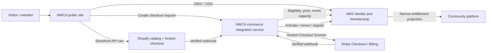

# NWCA Membership, Registration & Commerce Handoff

**Prepared for:** NWCA AMS and Community implementation team  
**Scope:** Membership purchase and annual renewal; donations with frequency; paid event registration; merchandise purchase; identity and community handoff.

> **Recommendation:** Make the **AMS the sole system of record for people, membership status, renewal terms, eligibility, event registration, and community entitlements**. Use **Stripe as the payment system of record for membership, renewal, donation, and event payments**. Use **Shopify as the commerce system of record for merchandise catalog, cart, checkout, orders, fulfillment, tax, and inventory**.

The NWCA website should be a branded presentation and purchase-intent layer only. It should **not** hold card data, become a second membership database, decide member eligibility, or create member accounts by email matching.

## Recommended architecture



## Source-of-truth boundaries

| Domain | Owner | Public-site responsibility |
| --- | --- | --- |
| Person / member ID, membership class, term, eligibility, event registration, community entitlement | **AMS** | Ask for current state; never mirror as authoritative data. |
| Card details, payment methods, payment state, invoices, subscriptions, refunds and disputes for membership/donation/event payments | **Stripe** | Redirect to hosted Stripe Checkout; receive no card data. |
| Product catalog, variants, pricing, inventory, cart, tax, fulfillment, merchandise order and refund state | **Shopify** | Build cart using Storefront API; redirect to Shopify hosted checkout. |
| Page UI, non-sensitive purchase selection, short-lived browser state | **NWCA website** | No payment processing; no entitlement grant. |
| Correlation IDs, webhook deduplication, retries, mapping of immutable AMS person ID to provider IDs | **Integration service** | Operational integration state only—not a duplicate AMS. |

## Customer flows

### 1. New membership purchase — always first

1. Visitor selects a NWCA membership tier on the NWCA site.
2. Offer **“Already a member? Sign in”** before collecting data. Use the AMS’s supported SSO (OIDC Authorization Code + PKCE where available).
3. If new, create a controlled AMS registration/intake record or use the AMS’s approved registration endpoint. **Do not use email as the canonical identity key.**
4. The integration service asks the AMS for an authoritative membership product/price and an opaque membership-intent ID.
5. The service creates a **server-side Stripe Checkout Session**, `mode=subscription`, using a server-owned annual Price ID. It returns only the hosted `checkoutUrl` to the browser.
6. The browser redirects to Stripe Checkout. The website never receives card numbers or CVC.
7. A verified Stripe webhook records payment and forwards the result, Stripe IDs, and opaque intent ID to the AMS.
8. The AMS applies its term and entitlement rules, then projects scoped access to the community platform.
9. The NWCA return page displays **pending/confirmed status from the integration service** but never activates benefits solely because a success URL was reached.

### 2. Annual renewal

1. Start with **AMS login**, not a new tier-selection form.
2. The AMS returns the membership record, renewal eligibility, renewal price, current term, and any grace-period logic.
3. The integration service creates the Stripe renewal Checkout Session using the AMS-generated intent and server-selected annual Price.
4. Stripe webhook confirmation updates the renewal in the AMS. Handle failed invoices, cancellation, refund, dispute, and retry paths.

### 3. Donation — add frequency

| Frequency | Stripe model | AMS effect |
| --- | --- | --- |
| One-time | Checkout `mode=payment` with server-validated amount | Record gift / acknowledgement only; do not infer membership. |
| Monthly | Checkout `mode=subscription` with recurring monthly donation Price | Record recurring donor relationship if NWCA needs it. |
| Annual | Checkout `mode=subscription` with recurring annual donation Price | Record recurring donor relationship if NWCA needs it. |

The public form can offer preset amounts and a custom amount, but the server must enforce minimums, currency, and any maximum/review rules. Use `submit_type=donate` where appropriate. Donation status is webhook-driven.

### 4. Event purchase / registration

1. Existing member signs in through the AMS; new visitor may create an AMS account if the event permits it.
2. The integration service requests **eligibility, member price, availability/capacity, add-ons, and an event-registration intent** from the AMS.
3. For paid registration, create Stripe Checkout `mode=payment` with the server-selected event Price.
4. On verified payment success, call the AMS’s registration confirmation endpoint with the opaque event intent ID and provider references.
5. For free events, bypass Stripe and confirm in the AMS directly.
6. The AMS owns registration status, badges, waitlist, CEU credit, cancellation, and attendance—not the public website.

### 5. Product purchase / headless Shopify

**Yes—use Shopify headless for merchandise, but keep it separate from membership accounting.**

1. Fetch catalog, variants, price, availability, and cart operations from Shopify Storefront API.
2. Build a Shopify Cart (`cartCreate`, line mutations, buyer identity where appropriate).
3. Immediately before handoff, retrieve the Cart `checkoutUrl` and redirect to **Shopify hosted checkout**.
4. Shopify owns shipping, tax, payment, order, fulfillment, refund, and inventory state.
5. Verify Shopify webhooks (HMAC on raw body), deduplicate by webhook ID, then only send minimal necessary order references to the AMS if a business process requires it.
6. If a member sees special merchandise pricing, let the **AMS authorize it**. Do not treat a Shopify tag or a front-end condition as proof of active membership.

## Identity and community practice

- Use the immutable **AMS person/member ID** as the cross-system primary key.
- Use the identity-provider `(issuer, subject)` pair for SSO identity linkage.
- Map Stripe Customer ID and Shopify Customer GID to that AMS identity only after verified linking.
- Treat email as a **mutable contact attribute / matching hint**, never as proof that two people are the same member.
- The community platform receives an entitlement projection: immutable external member ID, approved display profile fields, entitlement flags, expiration, provenance, and last verified timestamp.
- The community platform must accept revocation and must not perform membership renewal or establish membership eligibility.

## Server contract implemented by the new UI

The UI calls this endpoint once the integration service is available:

```http
POST {VITE_COMMERCE_API_URL}/v1/checkout-sessions
Content-Type: application/json
Cookie: AMS-backed browser session
```

```json
{
  "kind": "membership | renewal | donation | event | product",
  "customer": {
    "firstName": "Taylor",
    "lastName": "Coach",
    "email": "taylor@example.edu",
    "organization": "Example University"
  },
  "membershipPlanId": "collegiate",
  "donation": { "amountCents": 10000, "frequency": "monthly" },
  "event": { "eventId": "convention-2026", "passId": "full-registration" },
  "product": [{ "variantId": "gid://shopify/ProductVariant/...", "quantity": 1 }],
  "returnUrl": "https://www.example.org/checkout?status=success",
  "cancelUrl": "https://www.example.org/checkout?status=cancelled"
}
```

**Critical server rules**

- Authenticate the caller and derive the AMS person ID on the server.
- Never trust browser-supplied price, amount, currency, member status, entitlement, event capacity, or arbitrary return URL.
- Resolve prices and availability from the AMS, Stripe catalog, or Shopify catalog on the server.
- Return:

```json
{ "checkoutUrl": "https://checkout.stripe.com/...", "provider": "stripe", "referenceId": "opaque-intent-id" }
```

- Keep `VITE_COMMERCE_API_URL` and `VITE_AMS_LOGIN_URL` as public configuration values only. Stripe secret keys, webhook secrets, Shopify Admin/private tokens, AMS API secrets, OAuth client secrets, and webhook HMAC secrets stay server-side.

## Webhook rules

| Provider | Verification | Idempotency key | Resulting action |
| --- | --- | --- | --- |
| Stripe | Verify `Stripe-Signature` using the **raw request body** and endpoint secret | Stripe event ID | Reconcile confirmed payment/subscription state to an AMS intent; do not use browser redirect as proof. |
| Shopify | Verify `X-Shopify-Hmac-Sha256` using the **raw request body** | Shopify webhook ID | Record commerce result / fulfill integration task; do not copy catalog or membership state into AMS. |

Persist a small operational record: opaque attempt/intent ID, immutable AMS ID when known, provider object IDs, timestamps, last processed event ID, and processing/reconciliation status. Queue webhooks, acknowledge quickly, retry safely, and provide a manual-resolution path for ambiguous identity or failures.

## Recommended implementation sequence

1. **Confirm the AMS vendor contract:** SSO/OIDC support, API scopes, membership intent/renewal endpoints, event registration and pricing endpoint, webhook model, sandbox access, and membership owner.
2. **Create the integration service:** OIDC session validation, AMS adapter, Stripe Checkout Session creator, verified webhooks, event queue/retry, idempotency, and reconciliation dashboard.
3. **Enable membership + renewal:** Stripe annual subscription Prices, AMS synchronization, Customer Portal decision (use it only if AMS renewal policy permits), lifecycle tests.
4. **Enable donations + event registration:** donation frequency prices, custom donation validation, event capacity/member price logic, free-event bypass.
5. **Enable Shopify:** live Storefront catalog/variants, Cart API, hosted checkout handoff, order webhooks and fulfillment testing.
6. **Enable community projection:** scoped entitlement sync, revocation/expiration testing, duplicate-identity and changed-email procedures.

## Inputs required before go-live

- Selected AMS vendor and its current integration/API documentation.
- Confirmation of which platform owns the Stripe account and webhooks.
- Membership catalog, annual Stripe Price IDs, term/grace/cancellation policies, and member-price rules.
- Donation designation and frequency policy, tax/acknowledgement policy, and permitted custom amounts.
- Event data source, capacity/waitlist model, registration field requirements, and cancellation/refund rules.
- Shopify store domain, Storefront API access plan, Storefront token approach, Customer Account approach, and vendor fulfillment policy.
- Canonical domain, approved return URLs, branding, privacy/retention requirements, and support/escalation owner.

## Official references

- [Stripe Checkout](https://docs.stripe.com/checkout/quickstart)
- [Stripe Checkout Session API](https://docs.stripe.com/api/checkout/sessions/create)
- [Stripe webhook handling](https://docs.stripe.com/webhooks/handling-payment-events?lang=node&locale=en-GB)
- [Stripe subscription lifecycle](https://docs.stripe.com/billing/subscriptions/overview)
- [Shopify Storefront Cart API](https://shopify.dev/docs/storefronts/headless/building-with-the-storefront-api/cart/manage)
- [Shopify webhook verification](https://shopify.dev/docs/apps/build/webhooks/verify-deliveries)
- [Shopify Customer Account API](https://shopify.dev/docs/api/customer/latest)
- [OpenID Connect Core](https://openid.net/specs/openid-connect-core-1_0.html)

## What is already supplied in the UI handoff

- A routed **membership-first checkout** at `/checkout` with membership, annual renewal, donation frequency, event registration, and merchandise handoff states.
- A browser-side typed checkout contract that expects a secure integration-service response.
- Existing membership, donation, event, and gear buttons routed into the unified NWCA flow rather than sending users to scattered external pages.
- No payment credentials, API keys, or faux payment success logic.
